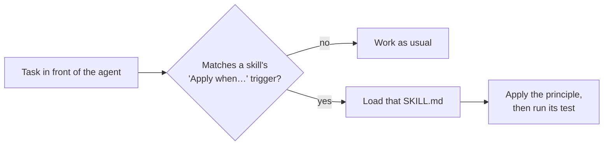

<div align="center">

# 🧭 agent-principles

**Engineering principles and craft skills your coding agent loads exactly when the work calls for them.**

[](https://github.com/lgarceau768/agent-principles/actions/workflows/lint.yml)
[](LICENSE)
[](https://agentskills.io)
[](#-install)
[](scripts/lint.mjs)

[Install](#-install) · [Principles](#-agent-principles) · [Craft](#-lstack-skills) · [How it works](#%EF%B8%8F-how-it-works) · [Contributing](#-contributing)

</div>

---

> These are a collection of the skills I've curated, use daily, and find to fit for my workflow best.
>
> — [Luke Garceau](https://github.com/lgarceau768)

Each skill is one short, opinionated `SKILL.md` about a class of problem: where
validation belongs, when a test actually proves anything, what to delete before
you add something new. They work as a checklist for an agent and as a reminder
for a person.

The marketplace holds two plugins. Install either, or both:

| Plugin | What it covers |
|---|---|
| 🧭 [**agent-principles**](#-agent-principles) | How to think about a problem: design, simplicity, verification, reliability, and working as an agent. |
| 🧰 [**lstack-skills**](#-lstack-skills) | How the work is written: test-first, TypeScript, comment audits, and plain prose. |

> [!TIP]
> These skills are not loaded all the time. Each one carries a trigger
> ("Apply when…"), so the agent loads a principle only when the task in front of
> it matches. Your context stays small, and the advice arrives when it is relevant.

## 🚀 Install

**Claude Code, as a plugin** (recommended):

```text
/plugin marketplace add lgarceau768/agent-principles
/plugin install agent-principles@agent-principles
/plugin install lstack-skills@agent-principles
```

<details>
<summary><b>Claude Code, as plain skills</b> (no plugin namespace)</summary>

```bash
git clone https://github.com/lgarceau768/agent-principles.git
cp -rf agent-principles/skills/* ~/.claude/skills/                         # principles
cp -rf agent-principles/plugins/lstack-skills/skills/* ~/.claude/skills/   # craft
# use .claude/skills/ instead to scope them to one project
```

</details>

<details>
<summary><b>Any other Agent Skills host</b></summary>

Copy the directories under [`skills/`](skills/) and
[`plugins/lstack-skills/skills/`](plugins/lstack-skills/skills/) into the host's
skills folder.
Each file uses only the five portable frontmatter fields, so it loads unchanged.

Keep the directories together, because several skills link to each other by
relative path.

</details>

## 🧭 agent-principles

How to think about a class of problem.

<!-- skills:begin -->
<p>
  
  
  
</p>

| | Group | What it's about |
|---|---|---|
| 🧱 | [Design and structure](#-design-and-structure) | Shape the code before you write it. |
| ✂️ | [Simplicity](#%EF%B8%8F-simplicity) | Less code, fewer layers, smaller diffs. |
| ✅ | [Verification](#-verification) | Know it works, and leave proof a reviewer can rerun. |
| 🛡️ | [Reliability and security](#%EF%B8%8F-reliability-and-security) | Behave correctly under retries, races, and hostile callers. |
| 🤖 | [Working as an agent](#-working-as-an-agent) | Spend context and the human's attention carefully. |

### 🧱 Design and structure

> Shape the code before you write it.

| Skill | The idea | Reach for it when… |
|---|---|---|
| **[Boundary discipline](skills/principle-boundary-discipline/SKILL.md)** | Validate at the edges, trust the inside, keep business logic pure. | Wiring validation, error handling, or a framework adapter. |
| **[Exhaust the design space](skills/principle-exhaust-the-design-space/SKILL.md)** | Prototype two or three real alternatives before you commit. | The decision is novel and the codebase has no precedent. |
| **[Experience first](skills/principle-experience-first/SKILL.md)** | The product is the experience. Choose delight over convenience. | Scope, UX, or polish trade-offs come up. |
| **[Foundational thinking](skills/principle-foundational-thinking/SKILL.md)** | Get the data structures right first and the code that follows becomes obvious. | Choosing core types, or deciding what to scaffold before features. |
| **[Model the domain](skills/principle-model-the-domain/SKILL.md)** | Put the domain in a data structure, not in a pile of if/else. | A feature adds one more branch or one more boolean to keep in sync. |
| **[Redesign from first principles](skills/principle-redesign-from-first-principles/SKILL.md)** | Build it as if the new requirement had been there on day one. | A new requirement is about to be bolted onto an old design. |
| **[Type system discipline](skills/principle-type-system-discipline/SKILL.md)** | Use the compiler as a proof assistant and make illegal states impossible to write. | Designing types or reviewing a signature in any typed language. |

### ✂️ Simplicity

> Less code, fewer layers, smaller diffs.

| Skill | The idea | Reach for it when… |
|---|---|---|
| **[Laziness protocol](skills/principle-laziness-protocol/SKILL.md)** | Borrow a tired maintainer's instincts: the least code that solves it. | You feel the urge to add a layer, abstraction, or new signal. |
| **[Migrate callers then delete legacy apis](skills/principle-migrate-callers-then-delete-legacy-apis/SKILL.md)** | Move every caller to the new API and delete the old one in the same pass. | A new internal API lands while old callers still exist. |
| **[Minimize reader load](skills/principle-minimize-reader-load/SKILL.md)** | Count the layers to trace and the state to hold, then shrink both. | Code is hard to follow, or you are about to add indirection. |
| **[Subtract before you add](skills/principle-subtract-before-you-add/SKILL.md)** | Delete dead weight first, then build on the smaller base. | Sequencing an addition, refactor, or rewrite. |

### ✅ Verification

> Know it works, and leave proof a reviewer can rerun.

| Skill | The idea | Reach for it when… |
|---|---|---|
| **[Build the lever](skills/principle-build-the-lever/SKILL.md)** | Write the codemod or script instead of doing it by hand. | The work is more than a couple of obvious edits. |
| **[Encode lessons in structure](skills/principle-encode-lessons-in-structure/SKILL.md)** | Turn a repeated instruction into a lint, a check, or a script. | You catch yourself giving the same correction twice. |
| **[Fix root causes](skills/principle-fix-root-causes/SKILL.md)** | Reproduce, ask why until you reach the cause, and fix it there. | Debugging, especially when a nil check would make it go away. |
| **[Prove it works](skills/principle-prove-it-works/SKILL.md)** | Check the real artifact, and show each guard test failing on purpose. | You are about to say “done”. |
| **[Sequence verifiable units](skills/principle-sequence-verifiable-units/SKILL.md)** | Small steps that each end green, ordered so the history proves itself. | Running a sweep or migration, or stacking commits and PRs. |

### 🛡️ Reliability and security

> Behave correctly under retries, races, and hostile callers.

| Skill | The idea | Reach for it when… |
|---|---|---|
| **[Authorize before you look up](skills/principle-authorize-before-you-look-up/SKILL.md)** 🆕 | Check permission before the fetch, or 403 vs 404 leaks what exists. | An endpoint or handler takes an id from the caller. |
| **[Make operations idempotent](skills/principle-make-operations-idempotent/SKILL.md)** | Running it twice, or after a crash, ends in the same state. | Designing commands, startup steps, or retry loops. |
| **[Separate before serializing shared state](skills/principle-separate-before-serializing-shared-state/SKILL.md)** | Give each writer its own target before reaching for locks. | Concurrent actors might write the same file, key, or branch. |

### 🤖 Working as an agent

> Spend context and the human's attention carefully.

| Skill | The idea | Reach for it when… |
|---|---|---|
| **[Guard the context window](skills/principle-guard-the-context-window/SKILL.md)** | Every token has to earn its place. Send bulk output to subagents. | Large files, long outputs, or wide fan-out fill the context. |
| **[Never block on the human](skills/principle-never-block-on-the-human/SKILL.md)** | Do the reversible thing, show the result, and ask only about the irreversible. | You are about to ask “should I do X?” |
| **[Outcome oriented execution](skills/principle-outcome-oriented-execution/SKILL.md)** | Converge on the target design. No throwaway compatibility shims. | Running a planned rewrite or migration in phases. |
<!-- skills:end -->

🆕 Original to this repository. Every other skill is derived from pstack (see
[Provenance](#-provenance)).

## 🧰 lstack-skills

How a thing is written. The principles say what good looks like; these are the
day-to-day habits that get there. `no-comments` and `typescript-best-practices`
lean on principles from the other plugin, so the two work best together.

<!-- lstack-skills:begin -->
<p>
  
  
</p>

| | Group | What it's about |
|---|---|---|
| 🛠️ | [Writing code](#%EF%B8%8F-writing-code) | Tests that can fail, types that mean something, no comments as crutches. |
| ✍️ | [Writing prose](#%EF%B8%8F-writing-prose) | Text a tired engineer reads once and understands. |

### 🛠️ Writing code

> Tests that can fail, types that mean something, no comments as crutches.

| Skill | The idea | Reach for it when… |
|---|---|---|
| **[No comments](plugins/lstack-skills/skills/no-comments/SKILL.md)** | Delete comments the code should have said itself, and fix what they hid. | A diff is ready for review and carries comments or suppressions. |
| **[Tdd](plugins/lstack-skills/skills/tdd/SKILL.md)** | Write the failing test first, then attack the assertion you just wrote. | Fixing a bug or building a unit whose check is a test. |
| **[Typescript best practices](plugins/lstack-skills/skills/typescript-best-practices/SKILL.md)** | Type-system discipline in TypeScript syntax: brands, unions, unknown over any. | Writing or reviewing any .ts or .tsx file. |

### ✍️ Writing prose

> Text a tired engineer reads once and understands.

| Skill | The idea | Reach for it when… |
|---|---|---|
| **[Bro](plugins/lstack-skills/skills/bro/SKILL.md)** | Say it again, plainly, without softening anything. | The last reply was thick with jargon. |
| **[Technical writing](plugins/lstack-skills/skills/technical-writing/SKILL.md)** | Writing a tired engineer understands on the first read. | Writing docs, records, PR descriptions, or commit messages. |
| **[Unslop](plugins/lstack-skills/skills/unslop/SKILL.md)** | Strip the AI tells out of prose and put a human voice back in. | Writing anything a person will read: PRs, commits, READMEs, replies. |
<!-- lstack-skills:end -->

## ⚙️ How it works



Every skill uses the same small shape:

```yaml
---
name: principle-prove-it-works
description: "Apply when a task is complete and you are about to declare it done. …"
license: MIT
metadata:
  derived-from: pstack@0.14.4   # present only on derived skills
  category: verification        # the README group
  summary: "…"                  # "The idea" column above
  when: "…"                     # "Reach for it when…" column above
---
```

The `description` is what the agent reads to decide whether to load the skill.
The `metadata` lines are for people: they generate the tables above.

## 🔖 Provenance

Both plugins come from **LStack**, a private agent stack where these skills are
the principle and craft layers its roles and workflows load by name. This
repository publishes only those layers, with references to the rest of the
stack removed. In `no-comments`, the stack's named roles became a generic
reviewer and implementer.

Most are derived from [pstack](https://github.com/cursor/plugins/tree/main/pstack)
v0.14.4 by Lauren Tan (MIT), and several have been extended since: `tdd` gained
"Attack the assertion you just wrote", and `prove-it-works` gained the guard-test
section. Each derived
skill names its source in its own frontmatter, so the attribution travels with
the file. [NOTICE.md](NOTICE.md) has the full notice.

## 🤝 Contributing

```bash
node scripts/lint.mjs          # check every skill, and that this README is current
node scripts/lint.mjs --write  # regenerate the skill tables after a change
```

| The lint enforces | Why |
|---|---|
| Only `name`, `description`, `license`, `compatibility`, `metadata` | Hosts silently drop fields they don't know |
| `name` matches its directory | Hosts resolve skills by name |
| `description` starts "Apply when" or "Use when" | It is a trigger, not a summary |
| `metadata.category`, `summary` and `when` are set and short | They generate the tables above |
| Every relative link resolves, and stays inside its plugin | Each plugin is installed on its own |
| Every plugin in `marketplace.json` is linted | A new plugin can't skip the checks |

CI runs the same check on every push and pull request.

## 📄 Licence

[MIT](LICENSE). The derived material also carries pstack's MIT notice, in
[NOTICE.md](NOTICE.md).
